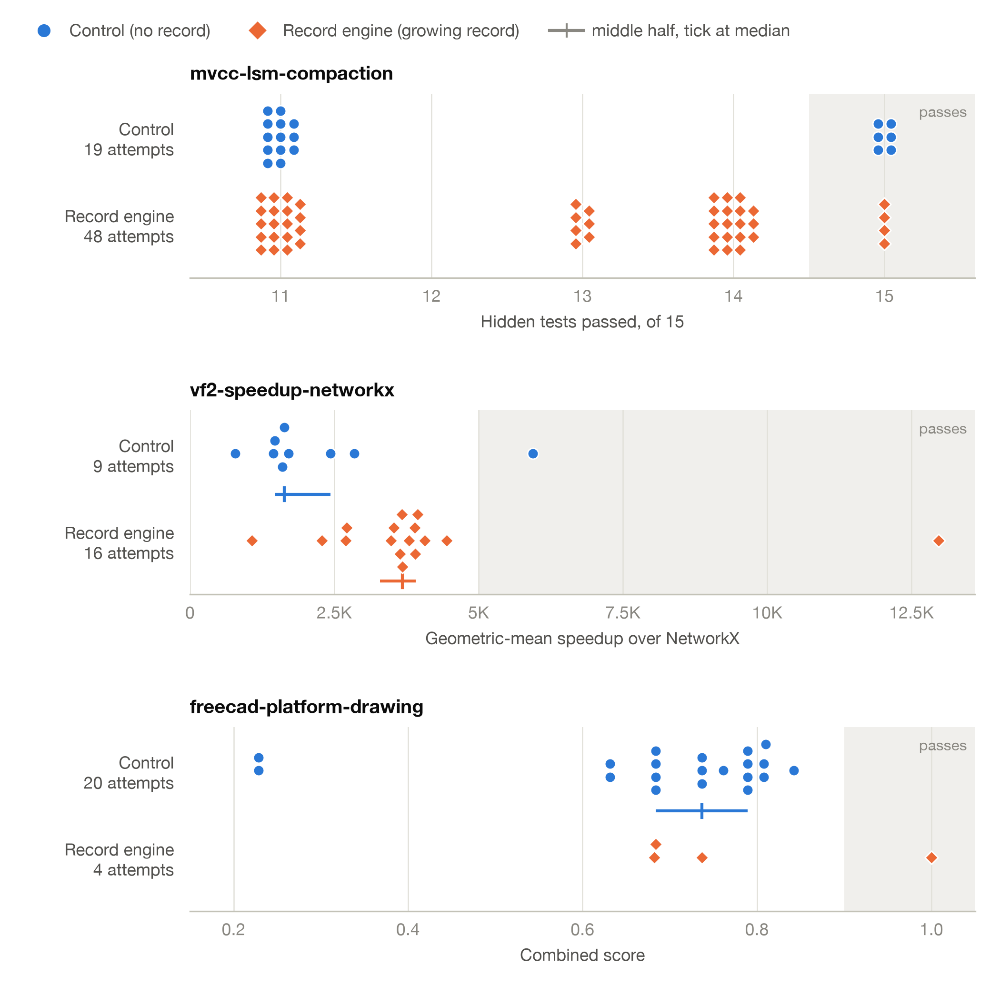

# Solved-by-k with a growing record: the pass@k probe of 2026-11-10

Status: design fixed before the first launch (2026-11-10, 06:15 UTC); results pending.
A probe on the development Mac, not a preregistered run.

## Question

Every probe from 2026-11-02 to 2026-11-06 ran one retry on one earlier attempt (k = 1).
At k = 1 the record is short enough to read whole, and record-engine and record-files did not differ (`2026-11-05_record-arm-probes-findings.md`).
This run asks what the single retries could not: when a chain keeps retrying until it passes, and each failed attempt is added to the record, does record-engine reach a first pass in fewer attempts than control?
The metric is the one Prof. Kaffes asked for, pass@k, read here as solved-by-k: the share of chains with a pass at or before attempt k.
In control the attempts are fresh resamples, so this is pass@k in the usual sense; in record-engine the attempts are sequential with memory (design spec §4), and the same curve is read as solved within k attempts.

## Design, fixed before the first launch

- **Arms.** `control` and `record-engine`. `record-files` is not run: it is the second stage, on the roots where record-engine separates from control.
- **Budget.** N = 20 retries per chain. A chain stops at its first pass.
- **The record grows.** The loop is `trajlab.exp2.loop.Exp2Runner` (ADR-0022) unchanged: after a failed record-engine attempt, `trajlab.exp2.chain.ingest` builds that attempt's calls, per-call deltas, and final message into the chain's store, and the next attempt's query server reads the store with attempts 0 to t-1.
  A chain's store holds only its own attempts.
- **Prompts.** `trajlab.exp2.prompt.prefix` unchanged: control's four protocol steps, and for record-engine the `v4` text (ADR-0024, amendment item 7).
  The note counts the earlier attempts in both arms ("k previous attempt(s) ... FAILED"), so the arms differ only in the record.
- **The given queries are not changed.** They were written for one earlier attempt and return every attempt's rows.
  Depth is the one factor this run changes; where the given queries hit the row cap or Claude Code's output cap is measured per attempt (`row_capped`, `cut_reads`), and whether agents filter by attempt (`attempt_filters`).
  A per-attempt comparison view is a store change that needs an ADR; this run is its evidence.
- **Sample.** Local roots with a schema 6 store, one chain per root and arm in each lane:

| Lane | Task | Roots | Chains |
|---|---|---|---|
| `passk-mv-a` | mvcc-lsm-compaction | `CsiwPnL`, `JVTs2ov`, `VTaE53Y` | 6 |
| `passk-vf-a` | vf2-speedup-networkx | `3Myfftk` (the root with the longer record, 25 calls) | 2 |
| `passk-fp-a` | freecad-platform-drawing | `KCcmLD8` | 2 |
| `passk-mv-b` | mvcc-lsm-compaction | the same three roots, a second chain each | 6 |

- **Capture.** One watcher on `corpus/exp2/passk-jobs` with the corpus's policy (`--every 1 --gate change`) for both arms, since a failed record-engine attempt is ingested from its per-call checkpoints and control must run under the same hook.
- **Order.** Two attempts at a time, as in every earlier probe. A free place goes to the chain whose next attempt has the lowest index, lanes in the table's order on a tie, so chains advance level by level and the two arms of a root run close in time.
- **Disk.** No image is deleted. Launches hold while the disk has less than 15 GB free.
- **Settings.** Claude Sonnet 5.5 at medium effort, Claude Code 2.1.278, amd64 under emulation, the subscription token of `.env` (`ANTHROPIC_API_KEY` removed from every attempt's environment), no write recorder.

## Outcomes

1. Attempts to a first pass per chain, censored at 20, per task and arm.
2. Solved-by-k for k = 1 to 20: chains with a first pass at or before k, over chains whose outcome at k is known.
3. The graded number by attempt index where the task has one: the verifier's geometric-mean speedup (vf2, gate 5,000x) and `combined` (freecad, gate 0.9).
4. Record use by depth in record-engine: queries, queries cut by the row cap, query calls whose output was cut to a preview, queries that filter on `attempt_idx`.

## What earlier numbers predict

Written before the run, from the single-retry probes.

- **mvcc.** Control passed 2 of 20 single retries and record-engine 6 of 20.
  If attempts were independent at those rates, control would be solved by k = 5 in 41% of chains and by k = 20 in 88%, and record-engine in 83% and nearly all.
  The value at 20 should not separate the arms; the attempts needed should (about 10 against about 3).
- **vf2.** Record-arm retries restored the root and landed at 2,273x to 5,554x; control wrote from scratch and landed at 86x to 2,443x.
  If each record-engine retry restores its predecessor and adds to it, the chain should climb toward the gate and control should not.
- **freecad.** The root (0.579) is below every fresh attempt (0.632 to 0.842), and all 30 single retries failed.
  A chain that restores its predecessor may stay below control's best fresh attempt.

## What this run is not

- Not preregistered, and not `trajlab exp2 run`: that command needs the write recorder, which macOS lacks, a clean tree, and a committed preregistration.
  `scripts/2026-11-10_exp2_passk_chains.py` drives the same runner with those gates replaced; its docstring lists each difference.
- One chain per root and arm on vf2 and freecad, two on mvcc: a chain's length is one draw.
- Three tasks, six roots, one Mac.

## Commands

From `../trajlab-fullctx` (branch `sl/exp2-full-context-diffs`, uncommitted on 7a4001a), Docker 29.8.0 with 8 CPUs and 8 GB:

    caffeinate -dimsu uv run trajlab watch corpus/exp2/passk-jobs --every 1 --gate change
    uv run python scripts/2026-11-10_exp2_passk_chains.py plan --out corpus/exp2/passk/plan.json \
        --budget 20 --arms control record-engine \
        --lane passk-mv-a corpus/stores/mvcc-local-v6 corpus/jobs/probe-mvcc-first \
            mvcc-lsm-compaction__CsiwPnL mvcc-lsm-compaction__JVTs2ov mvcc-lsm-compaction__VTaE53Y \
        --lane passk-vf-a corpus/stores/vf-local-v6 corpus/jobs/probe-night-vf-first \
            vf2-speedup-networkx__3Myfftk \
        --lane passk-fp-a corpus/stores/fp-local-v6 corpus/jobs/probe-night-fp-first \
            freecad-platform-drawing__KCcmLD8 \
        --lane passk-mv-b corpus/stores/mvcc-local-v6 corpus/jobs/probe-mvcc-first \
            mvcc-lsm-compaction__CsiwPnL mvcc-lsm-compaction__JVTs2ov mvcc-lsm-compaction__VTaE53Y
    uv run python scripts/2026-11-10_exp2_passk_chains.py check corpus/exp2/passk/plan.json
    env -u ANTHROPIC_API_KEY caffeinate -dimsu uv run python scripts/2026-11-10_exp2_passk_chains.py \
        run corpus/exp2/passk/plan.json
    uv run python scripts/2026-11-10_exp2_passk_chains.py report corpus/exp2/passk/plan.json

The check before launch: 4 lanes, 320 prompts (each root, arm, and k from 1 to 20), none names a check or quotes verifier text; the longest is 7,938 bytes.

## Results

Pending: the run was paused by the owner at 12:22 EST with 116 attempts counted and one left to launch (attempt 20 of the second `VTaE53Y` record-engine chain).

### Interim figure (116 attempts)

Regenerate with:

    uv run python scripts/2026-11-10_exp2_passk_chains.py report corpus/exp2/passk/plan.json \
        > corpus/exp2/passk/report.json
    uv run --script scripts/2026-11-10_exp2_passk_figures.py --report corpus/exp2/passk/report.json \
        --out docs/experiments/exp2/figures/2026-11-10_passk

**Figure 1.** Where each attempt's verifier score landed, per task and arm.
One mark per counted attempt; the shaded band is the scores that pass the task; the line under a row covers the middle half of the arm's attempts, with a tick at the median (drawn where the score is continuous and the arm has at least 8 attempts).
An arm's attempts are pooled over its chains, and the attempts of one chain are not independent: in record-engine each attempt could read the ones before it.
On mvcc, the 39 record-engine attempts of the two `VTaE53Y` chains are 39 of the arm's 48.

